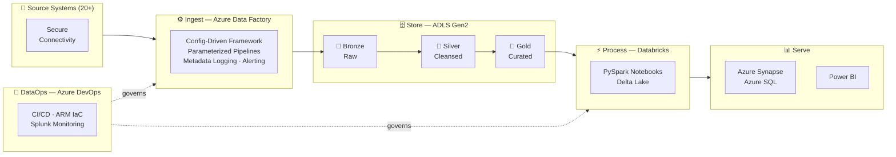

<div align="center">

<!-- ANIMATED WAVE HEADER -->


<!-- PROFILE PHOTO -->


<br/>

<!-- ANIMATED TYPING TAGLINE -->


<br/><br/>

<!-- SOCIAL BADGES -->
[](https://ashishpurohit30.github.io)&nbsp;
[](https://linkedin.com/in/ashishpurohit30)&nbsp;
[](mailto:ashishpurohit3007@gmail.com)&nbsp;
[](assets/Resume_AshishPurohit.pdf)

<br/>

&nbsp;
&nbsp;


</div>

---

## 🎯 Who I Am

> **Data Engineering Manager** with **9.5 years** architecting, modernizing, and scaling enterprise data platforms on Microsoft Azure — specializing in **Azure Databricks, Azure Data Factory, Synapse Analytics, Lakehouse architecture, and distributed data processing**. Currently **Solution Architect and Technical Lead**, leading and mentoring **20+ data engineers**.

I delivered metadata-driven ingestion frameworks running **100+ production pipelines across 20+ source systems (~100 GB daily)**, migrated a **3.5 TB data warehouse** to Azure Synapse (60+ SSIS packages, 80+ stored procedures, 600+ reports moved to Power BI), and drove **~70% faster source onboarding, ~40% lower infrastructure costs, and ~30% faster data processing**. Now extending that foundation with **Databricks Genie**.

---

## ⚡ Impact at a Glance

<div align="center">

|  🗓️ 9.5 Years  |  ⚙️ 100+ Pipelines  |  📦 3.5 TB Migrated  |  👥 20+ Engineers Led  |  🚀 ~70% Faster Onboarding  |  💸 ~40% Lower Infra Cost  |
|:---:|:---:|:---:|:---:|:---:|:---:|
| Enterprise Azure data platforms | Production, across 20+ source systems (~100 GB/day) | DW moved to Azure Synapse; 600+ reports to Power BI | Led and mentored across programs | New-source onboarding via config-driven orchestration | Spark tuning & efficient compute/storage use |

</div>

---

## 🤖 Automation & AI-Ready Engineering

> Automation-first engineering that makes data platforms faster to extend and ready for AI-assisted workflows.

<table>
<tr>
<td width="50%" valign="top">

### ⚡ Databricks Genie
Hands-on with **Databricks Genie** for natural-language access to lakehouse data and AI-assisted engineering workflows.

</td>
<td width="50%" valign="top">

### 🔁 Config-Driven Automation
Architected a **config-driven, metadata-based ingestion framework** on ADF/ADB delivering **100+ production pipelines across 20+ source systems** — cutting new-source onboarding time by **~70%**.

</td>
</tr>
<tr>
<td width="50%" valign="top">

### ⚙️ Spark Performance Optimization
Optimized **Databricks notebooks and Spark workloads** through tuning and efficient compute, network, and storage use — reducing infrastructure costs by **~40%**.

</td>
<td width="50%" valign="top">

### 📡 Observability & Reliability
Centralized **Splunk** logging, automated email alerting for ADF/ADB failures, and **T-SQL audit logging** — accelerating incident response and keeping platforms within SLAs.

</td>
</tr>
</table>


---

## 🏗️ Architecture: Azure Lakehouse Platform



> Secure connectivity and access controls, Splunk monitoring, and IaC-driven CI/CD across DEV/UAT/PROD.

---

## 🛠️ Core Technology Stack

<div align="center">

**☁️ Azure Data Platform**


**⚡ Processing & Storage**


**🛡️ Governance & DevOps**


</div>

---

## 🚀 Signature Projects

### 🏥 Enterprise Lakehouse Platform — Pharmaceuticals (US)

> **`ADF` + `Azure Databricks` + `Delta Lake` + `ADLS Gen2` + `T-SQL` + `Splunk`**

<table>
<tr>
<td><b>📊 100+ Production Pipelines</b></td>
<td><b>🔗 20+ Source Systems</b></td>
<td><b>📥 ~100 GB Loaded Daily</b></td>
<td><b>🚀 ~70% Faster Onboarding</b></td>
<td><b>💸 ~40% Lower Infra Cost</b></td>
</tr>
</table>

- 🏗️ Architected a **config-driven ingestion framework** with ADF/ADB, overseeing end-to-end delivery of **100+ production pipelines** loading **100 GB+ daily** across **20+ enterprise source systems**
- 👥 Managed and mentored **20+ data engineers**, aligning with Tech Leads and Solution Architects on business and technical outcomes
- 🚀 Cut new-source onboarding time by nearly **70%** with config-driven orchestration that minimizes custom development
- 🥇 Designed a **Medallion Lakehouse** on ADLS Gen2 — **~2 TB+** and millions of records processed through scalable **PySpark** transformations in Azure Databricks
- 💸 Optimized Databricks notebooks and Spark workloads, reducing infrastructure costs by **~40%** through tuning and efficient compute/network/storage use
- 📊 Built centralized observability with **Splunk** logging and automated email alerting; engineered **T-SQL stored procedures** for audit and file-level metadata logging
- 🔁 Architected an **IaC-driven CI/CD framework** for ADF pipelines and datasets with selective DEV/UAT/PROD deployment
- 🧹 Automated **Delta Lake maintenance** — file archival, VACUUM, retention-based cleanup — to control platform costs

---

### 🚗 Enterprise DW Migration — Auto Auctions (US)

> **`Azure Synapse` + `Power BI` + `SSIS` + `SSRS` + `T-SQL` + `Azure DevOps`**

<table>
<tr>
<td><b>📦 3.5 TB</b> Warehouse Migrated</td>
<td><b>📈 600+ Reports</b> SSRS → Power BI</td>
<td><b>⚙️ 60+ SSIS Packages</b> Re-engineered</td>
<td><b>📐 80+ Stored Procedures</b> Re-written</td>
<td><b>👥 Team of 6</b> Engineers Led</td>
</tr>
</table>

- ☁️ Led end-to-end migration of a legacy on-prem BI platform for a major US auto-auctions firm to **Azure Synapse Analytics & Power BI**
- 🔄 Re-engineered **60+ SSIS packages** into Synapse pipelines, preserving business logic while improving orchestration, scalability, and reliability
- ✅ Re-wrote **80+ legacy stored procedures** in Synapse dedicated SQL pool-compatible T-SQL, ensuring functional parity for dimension and fact workloads
- 🛠️ Troubleshot and fixed **60+ stored procedures** to keep KPI tables consistent across all dimension and fact sources
- 📊 Engineered ingestion/validation frameworks to **quarantine corrupted files** and integrated **REST APIs** for near-real-time Power BI activity logging
- 🚀 Architected **CI/CD** for Synapse pipelines and stored procedures — parameterized configs, connection management, and secure secret handling
- 👥 Led a team of **6 data engineers**, collaborating with platform owners and stakeholders to stabilize the cloud data platform

---

## 💼 Experience Timeline

<table>
<tr>
<th>Period</th>
<th>Role</th>
<th>Organization</th>
<th>Highlights</th>
</tr>
<tr>
<td><b>Jan 2024<br/>→ Present</b></td>
<td>🏆 <b>Manager</b><br/>Data Management</td>
<td>Blue Altair<br/>India Pvt. Ltd.</td>
<td>Solution Architect & Technical Lead · Led 20+ engineers · DataOps framework · Production stability & SLAs · Databricks Partner Connect Lead</td>
</tr>
<tr>
<td><b>Jan 2022<br/>→ Dec 2023</b></td>
<td>⭐ <b>Senior Consultant</b><br/>Data Management</td>
<td>Blue Altair<br/>India Pvt. Ltd.</td>
<td>Founder's Award (2023)</td>
</tr>
<tr>
<td><b>Jun 2020<br/>→ Dec 2021</b></td>
<td>🔵 <b>Consultant</b><br/>Data Management</td>
<td>Blue Altair<br/>India Pvt. Ltd.</td>
<td>Azure data platform delivery</td>
</tr>
<tr>
<td><b>May 2017<br/>→ Jun 2020</b></td>
<td>💻 <b>Application Dev Analyst</b></td>
<td>Accenture</td>
<td>Angular 6 · Node.js · MongoDB · Full-stack delivery for a US digital marketing client</td>
</tr>
</table>

---

## 🏆 Recognition & Awards

<table>
<tr>
<td align="center" width="33%">

### 🏆 Founder's Award
**Blue Altair · 2023**

Recognised for exceptional performance while managing multiple clients and projects concurrently.

</td>
<td align="center" width="33%">

### ⭐ Multiple Spot Awards
**Blue Altair**

Recognised for delivery excellence, strong customer outcomes, and end-to-end ownership — plus multiple client recognitions for high-quality delivery.

</td>
<td align="center" width="33%">

### 🎓 Director's Medal
**JECRC · Rajasthan Technical University**

Awarded 3rd rank in 6th semester and the Director's Medal for academic excellence in B.Tech (Hons) Computer Science & Engineering at Rajasthan Technical University.

</td>
</tr>
</table>

---

## 📐 Competency Map

```
Data Platform Architecture     ████████████████████  Expert
Azure Data Factory (ADF)       ████████████████████  Expert
Apache Spark / PySpark         ████████████████████  Expert
Azure Databricks               ████████████████████  Expert
Delta Lake / Lakehouse         ███████████████████░  Expert
CI/CD & DataOps                ██████████████████░░  Advanced
Azure Synapse / Enterprise DW  ██████████████████░░  Advanced
Databricks Genie               ███████████████░░░░░  Hands-on ⚡
```

---

## 🎓 Education

**🏫 B.Tech. (Hons) in Computer Science & Engineering**
JECRC Jaipur · Rajasthan Technical University · `2013 – 2017` · Director's Medal Recipient

HSC (2013) · SSC (2011) — Central Board of Secondary Education

---

## 📬 Let's Connect

<div align="center">

*I welcome conversations around data engineering leadership, Azure lakehouse modernization, Databricks &amp; AI platform architecture, and scaling data teams.*

<br/>

[](https://ashishpurohit30.github.io)&nbsp;
[](https://linkedin.com/in/ashishpurohit30)&nbsp;
[](mailto:ashishpurohit3007@gmail.com)&nbsp;
[](tel:+919413846168)

<br/>

<!-- ANIMATED WAVE FOOTER -->


</div>
