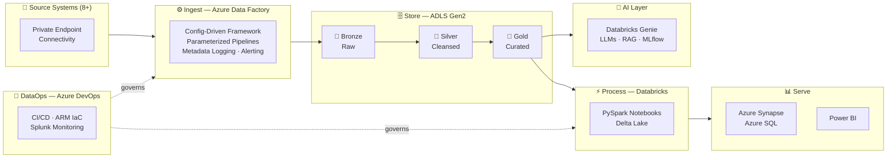

<div align="center">

<!-- ANIMATED WAVE HEADER -->


<!-- PROFILE PHOTO -->


<br/>

<!-- ANIMATED TYPING TAGLINE -->


<br/><br/>

<!-- SOCIAL BADGES -->
[](https://ashishpurohit30.github.io)&nbsp;
[](https://linkedin.com/in/ashishpurohit30)&nbsp;
[](mailto:ashishpurohit3007@gmail.com)&nbsp;
[](assets/Resume_AshishPurohit.pdf)

<br/>

&nbsp;
&nbsp;


</div>

---

## 🎯 Who I Am

> **Manager, Data Engineering** with 9+ years designing, building, and scaling enterprise-grade data platforms on Azure — specializing in **lakehouse architecture, distributed data processing, and cloud-native ETL/ELT**. I work as a **Solution Architect and Technical Lead**, owning strategy, technical design, and delivery.

I architected a **config-driven, metadata-based ADF ingestion framework**, built end-to-end lakehouse solutions on **ADF + Azure Databricks + ADLS Gen2**, migrated a **5TB+ enterprise data warehouse** to Azure Synapse, and built the **DataOps framework** that keeps parallel teams shipping reliably. Now extending that foundation with **Databricks Genie and LLM tooling**.

---

## ⚡ Impact at a Glance

<div align="center">

|  🗓️ 9+ Years  |  ⚙️ 100+ Lakehouse Pipelines  |  📦 5TB+ Migrated  |  🔗 10+ Source Systems  |  🔄 120+ Pipelines & Procs Modernized  |
|:---:|:---:|:---:|:---:|:---:|
| Enterprise Azure data engineering & platform leadership | Built on a config-driven ADF ingestion framework | Enterprise DW moved to Azure Synapse with minimal downtime | Connected over private endpoints | SSIS and stored procedures re-engineered for Synapse |

</div>

---

## 🤖 AI & Agentic Data Engineering

> Extending a solid Azure lakehouse foundation with AI-assisted and agentic workflows.

<table>
<tr>
<td width="50%" valign="top">

### ⚡ Databricks Genie
Hands-on with **Databricks Genie** for natural-language access to lakehouse data and AI-assisted engineering workflows.

</td>
<td width="50%" valign="top">

### 🔍 RAG & LLM Pipelines
Working with **LLMs** and **retrieval-augmented generation (RAG)** patterns over enterprise data.

</td>
</tr>
<tr>
<td width="50%" valign="top">

### 🧠 LangChain & Agentic Workflows
Using **LangChain** to compose LLM-powered applications and agentic workflows, with prompt engineering for data-centric tasks.

</td>
<td width="50%" valign="top">

### 📈 MLflow
**MLflow** for tracking experiments and managing models alongside the Databricks lakehouse.

</td>
</tr>
</table>

**AI Stack:**


---

## 🏗️ Architecture: Azure Lakehouse Platform



> Secured via private endpoints, monitored with Splunk, and promoted across environments through IaC-based CI/CD.

---

## 🛠️ Core Technology Stack

<div align="center">

**☁️ Azure Data Platform**


**⚡ Processing & Storage**


**🛡️ Governance, DevOps & MLOps**


</div>

---

## 🚀 Signature Projects

### 🏥 Enterprise Lakehouse Platform — Pharmaceuticals (US)

> **`ADF` + `Azure Databricks` + `Delta Lake` + `ADLS Gen2` + `Azure SQL` + `Splunk`**

<table>
<tr>
<td><b>📊 50+ Pipelines</b></td>
<td><b>🔗 8+ Source Systems</b></td>
<td><b>⚙️ 20+ Parameterized Load Pipelines</b></td>
</tr>
</table>

- 🏗️ Built a **config-driven, metadata-based ADF ingestion framework** and led end-to-end development of **50+ pipelines**
- 🔗 Connected **8+ source systems** over private endpoints; built **20+ parameterized pipelines** for full and incremental loads
- 🥇 Standardized raw ingestion into ADLS and transformed it into Delta tables with **PySpark notebooks** in Azure Databricks, structured as **Medallion (Bronze/Silver/Gold)**
- 🔁 Built reusable trigger/orchestration pipelines so new plant onboardings are repeatable and low-effort
- 📊 Set up **Splunk monitoring and email alerting**; developed **T-SQL stored procedures** in Azure SQL DB for centralized, auditable ADF metadata logging
- 💸 Built daily maintenance pipelines to **optimize/vacuum Delta tables** and purge storage by retention, controlling storage and compute costs
- 🚀 Designed an **IaC-based CI/CD framework** enabling selective (partial) promotions across environments

---

### 🚗 Enterprise DW Migration — Auto Auctions (US)

> **`Azure Synapse` + `Azure SQL DW` + `SSIS` + `T-SQL` + `Azure DevOps` + `Power BI`**

<table>
<tr>
<td><b>📦 5TB+</b> Migrated</td>
<td><b>⚙️ 120+ Pipelines / Stored Procedures</b></td>
<td><b>📐 ~100 Dimension/Fact Tables</b></td>
<td><b>🔧 60+ Stored Procedures Fixed</b></td>
</tr>
</table>

- ☁️ Led migration of a legacy on-prem BI platform to **Azure Synapse Analytics** with minimal downtime and business continuity
- 🔄 Re-engineered **SSIS packages** into Synapse pipelines while preserving legacy behavior
- ✅ Converted stored procedures to **Azure SQL DW-compatible T-SQL** and validated parity for all dimension and fact loads
- 🛠️ Troubleshot and fixed **60+ stored procedures** to keep KPI tables consistent and executive dashboards reliable
- 📊 Built ingestion/validation pipelines to **quarantine corrupted files** and enabled near real-time **Power BI activity logging via REST APIs**
- 🚀 Implemented **CI/CD** for Synapse pipelines and stored procedures with parameterized connections and secrets, plus **branching strategies** for parallel team development

---

## 💼 Experience Timeline

<table>
<tr>
<th>Period</th>
<th>Role</th>
<th>Organization</th>
<th>Highlights</th>
</tr>
<tr>
<td><b>Jan 2024<br/>→ Present</b></td>
<td>🏆 <b>Manager</b><br/>Data Management</td>
<td>Blue Altair<br/>India Pvt. Ltd.</td>
<td>Solution Architect & Technical Lead · DataOps framework · Production stability & SLAs · Databricks Partner Connect lead</td>
</tr>
<tr>
<td><b>Jan 2022<br/>→ Dec 2023</b></td>
<td>⭐ <b>Senior Consultant</b><br/>Data Management</td>
<td>Blue Altair<br/>India Pvt. Ltd.</td>
<td>Pharma lakehouse & auto-auctions Synapse migration engagements · Founder's Award (2023)</td>
</tr>
<tr>
<td><b>Jun 2020<br/>→ Dec 2021</b></td>
<td>🔵 <b>Consultant</b><br/>Data Management</td>
<td>Blue Altair<br/>India Pvt. Ltd.</td>
<td>Azure data platform delivery</td>
</tr>
<tr>
<td><b>May 2017<br/>→ Jun 2020</b></td>
<td>💻 <b>Application Dev Analyst</b></td>
<td>Accenture</td>
<td>Angular 6 · Node.js · MongoDB · Full-stack delivery for a US digital marketing client</td>
</tr>
</table>

---

## 🏆 Recognition & Awards

<table>
<tr>
<td align="center" width="33%">

### 🏆 Founder's Award
**Blue Altair · 2023**

Recognised for exceptional performance while managing multiple clients and projects concurrently.

</td>
<td align="center" width="33%">

### ⭐ Multiple Spot Awards
**Blue Altair**

Recognised for delivery excellence, strong customer outcomes, and end-to-end ownership.

</td>
<td align="center" width="33%">

### 🎓 Director's Medal
**JECRC · Rajasthan Technical University**

Awarded 3rd rank in 6th semester and the Director's Medal for academic excellence in B.Tech (Hons) Computer Science & Engineering at Rajasthan Technical University.

</td>
</tr>
</table>

---

## 📐 Competency Map

```
Data Platform Architecture     ████████████████████  Expert
Azure Data Factory (ADF)       ████████████████████  Expert
Apache Spark / PySpark         ████████████████████  Expert
Azure Databricks               ████████████████████  Expert
Delta Lake / Lakehouse         ███████████████████░  Expert
CI/CD & DataOps                ██████████████████░░  Advanced
Azure Synapse / Enterprise DW  ██████████████████░░  Advanced
Databricks Genie / LLM tools   ███████████████░░░░░  Hands-on ⚡
```

---

## 🎓 Education

**🏫 B.Tech. (Hons) in Computer Science & Engineering**
JECRC Jaipur · Rajasthan Technical University · `2013 – 2017` · Director's Medal Recipient

HSC (2013) · SSC (2011) — Central Board of Secondary Education

---

## 📬 Let's Connect

<div align="center">

*I welcome conversations around data engineering leadership, Azure lakehouse modernization, Databricks &amp; AI platform architecture, and scaling data teams.*

<br/>

[](https://ashishpurohit30.github.io)&nbsp;
[](https://linkedin.com/in/ashishpurohit30)&nbsp;
[](mailto:ashishpurohit3007@gmail.com)&nbsp;
[](tel:+919413846168)

<br/>

<!-- ANIMATED WAVE FOOTER -->


</div>
